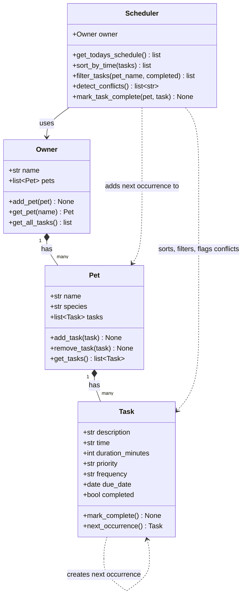

# PawPal+ (Module 2 Project)

You are building **PawPal+**, a Streamlit app that helps a pet owner plan care tasks for their pet.

## Scenario

A busy pet owner needs help staying consistent with pet care. They want an assistant that can:

- Track pet care tasks (walks, feeding, meds, enrichment, grooming, etc.)
- Consider constraints (time available, priority, owner preferences)
- Produce a daily plan and explain why it chose that plan

Your job is to design the system first (UML), then implement the logic in Python, then connect it to the Streamlit UI.

## Features

- **Owner and pet management:** enter an owner name and add any number of pets (name and species).
- **Task scheduling:** add tasks for a pet with a time, duration, priority and frequency (once, daily or weekly).
- **Sorted daily schedule:** today's tasks across all pets, ordered by time (`Scheduler.get_todays_schedule()`, `Scheduler.sort_by_time()`).
- **Filtering:** view tasks by pet and/or by completion status (`Scheduler.filter_tasks()`).
- **Conflict warnings:** tasks at the same date and time, for the same pet or different pets, are flagged without crashing the app (`Scheduler.detect_conflicts()`).
- **Daily and weekly recurrence:** completing a recurring task automatically schedules the next occurrence (`Task.next_occurrence()`, `Scheduler.mark_task_complete()`).
- **Tests:** an automated pytest suite covering the core scheduling behaviors.

## Getting started

### Setup

```bash
python -m venv .venv
source .venv/bin/activate  # Windows: .venv\Scripts\activate
pip install -r requirements.txt
```

### Running the app

```bash
python -m streamlit run app.py   # the Streamlit UI
python main.py                   # CLI demo of the scheduling logic
```

## System Architecture

The logic lives in `pawpal_system.py` and is independent of the UI. The source diagram is in [diagrams/uml_final.mmd](diagrams/uml_final.mmd).



## 🖥️ Sample Output

Output from running `python main.py`:

```
Today's Schedule for D'Jaine (2026-10-28)
--------------------------------------------------
07:30  Morning walk  Mochi      30 min  [high]    [ ]
08:00  Feeding       Whiskers   10 min  [high]    [x]
09:00  Grooming      Mochi      20 min  [low]     [ ]
09:00  Medication    Whiskers    5 min  [high]    [ ]
15:30  Playtime      Whiskers   15 min  [low]     [ ]
18:00  Evening walk  Mochi      30 min  [medium]  [ ]
18:00  Training      Mochi      15 min  [medium]  [ ]

Conflict warnings
--------------------------------------------------
WARNING: Conflict on 2026-10-28 at 18:00: Evening walk (Mochi), Training (Mochi)
WARNING: Conflict on 2026-10-28 at 09:00: Grooming (Mochi), Medication (Whiskers)

Mochi's tasks
--------------------------------------------------
07:30  Morning walk  Mochi      30 min  [high]    [ ]
09:00  Grooming      Mochi      20 min  [low]     [ ]
18:00  Evening walk  Mochi      30 min  [medium]  [ ]
18:00  Training      Mochi      15 min  [medium]  [ ]

Incomplete tasks
--------------------------------------------------
07:30  Morning walk  Mochi      30 min  [high]    [ ]
08:00  Feeding       Whiskers   10 min  [high]    [ ]  due 2026-10-29
09:00  Grooming      Mochi      20 min  [low]     [ ]
09:00  Medication    Whiskers    5 min  [high]    [ ]
15:30  Playtime      Whiskers   15 min  [low]     [ ]
18:00  Evening walk  Mochi      30 min  [medium]  [ ]
18:00  Training      Mochi      15 min  [medium]  [ ]

Completed tasks
--------------------------------------------------
08:00  Feeding       Whiskers   10 min  [high]    [x]

Whiskers' incomplete tasks
--------------------------------------------------
08:00  Feeding       Whiskers   10 min  [high]    [ ]  due 2026-10-29
09:00  Medication    Whiskers    5 min  [high]    [ ]
15:30  Playtime      Whiskers   15 min  [low]     [ ]

After completing Morning walk (daily) and Medication (once)
--------------------------------------------------
09:00  Grooming      Mochi      20 min  [low]     [ ]
15:30  Playtime      Whiskers   15 min  [low]     [ ]
18:00  Evening walk  Mochi      30 min  [medium]  [ ]
18:00  Training      Mochi      15 min  [medium]  [ ]
07:30  Morning walk  Mochi      30 min  [high]    [ ]  due 2026-10-29
08:00  Feeding       Whiskers   10 min  [high]    [ ]  due 2026-10-29
```

## 🧪 Testing PawPal+

Run the full test suite from the project root:

```bash
python -m pytest
```

The tests in `tests/test_pawpal.py` cover:

- **Task basics:** `mark_complete()` changes a task's status, and adding a task to a pet increases its task count.
- **Sorting:** tasks from different pets come back in chronological order, and today's schedule skips tasks due on other days or when there are no tasks at all.
- **Recurrence:** completing a daily task creates a new task due the next day, and a weekly task one due 7 days later. One-time tasks create nothing, and completing a task twice does not create a duplicate.
- **Conflict detection:** tasks sharing a date and time are flagged, whether they belong to the same pet or different pets, and a warning lists every task involved. Different times, different days and completed tasks are not flagged.
- **Filtering:** by pet name (case-insensitive), by completion status, by both together, and an unknown pet returns an empty list.

Sample test output:

```
============================= test session starts =============================
platform win32 -- Python 3.13.7, pytest-9.0.2, pluggy-1.6.0
rootdir: C:\Users\djain\Documents\BrownSchoolFiles\5. FAU\Courses by Semester\Fall 2026\Principles of Software Engineering\Codepath\Week 4\ai110-module2show-pawpal-starter
plugins: anyio-4.15.1
collected 11 items

tests\test_pawpal.py ...........                                         [100%]

============================= 11 passed in 0.05s ==============================
```

**Confidence level: ★★★★☆ (4/5).** All 11 tests pass and the core behaviors (sorting, recurrence, conflict detection, filtering) are covered, including several edge cases. I did not give it 5 stars because conflict detection only matches exact times and does not catch overlapping durations.

## 📐 Smarter Scheduling

| Feature | Method(s) | How it works |
|---------|-----------|--------------|
| Sorting by time | `Scheduler.sort_by_time()`, `Scheduler.get_todays_schedule()` | Sorts by due date, then by the "HH:MM" string, using a lambda key. Ties keep their original order. Today's schedule keeps only tasks due today. |
| Filtering | `Scheduler.filter_tasks(pet_name, completed)` | Filters by pet name (case-insensitive) and/or completion status. Both filters are optional and can be combined. |
| Conflict detection | `Scheduler.detect_conflicts()` | Groups incomplete tasks by date and time and returns a warning message for each group with more than one task. Covers same-pet and cross-pet clashes and never raises an error. |
| Recurring tasks | `Task.next_occurrence()`, `Scheduler.mark_task_complete()` | Completing a daily or weekly task creates a copy due 1 or 7 days after the original due date. Completing the same task twice does not create a duplicate. |

**Tradeoff:** conflicts are only flagged when two tasks share the exact same date and time. Overlapping durations are not checked. See section 2b of [reflection.md](reflection.md).

## 📸 Demo Walkthrough

Run the app with `python -m streamlit run app.py`.

**Main UI features**

- **Owner:** an editable owner name.
- **Pets:** add pets by name and species. Duplicate or blank names are rejected with a warning.
- **Add a Task:** pick a pet, then set a description, time, duration, priority and frequency.
- **Today's Schedule:** shows today's tasks sorted by time with a Done column, a dropdown to mark a task complete, and a warning for each scheduling conflict.
- **All Tasks:** every task across all dates, with filters for pet and status.

**Example workflow**

1. Add a pet, for example Mochi the dog, and a second one, Whiskers the cat.
2. Add tasks for each pet: Mochi's "Morning walk" at 07:30 (daily) and Whiskers' "Medication" at 09:00 (once). Adding them in any order is fine.
3. Add a third task, Mochi's "Grooming" at 09:00. The schedule now shows a yellow warning that Grooming (Mochi) and Medication (Whiskers) are both at 09:00.
4. Check Today's Schedule. The tasks appear in time order, and a task's Done column shows ⬜.
5. Choose "Morning walk" under "Mark a task complete" and click **Mark complete**. It is checked off ✅ and a message says the next daily occurrence is scheduled for tomorrow.
6. Open All Tasks and filter by pet or status. Tomorrow's Morning walk now appears there with its date.

**Key Scheduler behaviors shown**

- **Sorting:** the schedule is ordered by time regardless of the order tasks were added.
- **Conflict warnings:** tasks sharing a date and time are flagged for the same pet or different pets, and the app keeps running.
- **Recurrence:** completing a daily or weekly task creates the next occurrence, and completing it again does not duplicate it.
- **Filtering:** by pet name and completion status.

**Sample CLI output** (excerpt of `python main.py`; the full output is in Sample Output above):

```
Today's Schedule for D'Jaine (2026-10-28)
--------------------------------------------------
07:30  Morning walk  Mochi      30 min  [high]    [ ]
08:00  Feeding       Whiskers   10 min  [high]    [x]
09:00  Grooming      Mochi      20 min  [low]     [ ]
09:00  Medication    Whiskers    5 min  [high]    [ ]
15:30  Playtime      Whiskers   15 min  [low]     [ ]
18:00  Evening walk  Mochi      30 min  [medium]  [ ]
18:00  Training      Mochi      15 min  [medium]  [ ]

Conflict warnings
--------------------------------------------------
WARNING: Conflict on 2026-10-28 at 18:00: Evening walk (Mochi), Training (Mochi)
WARNING: Conflict on 2026-10-28 at 09:00: Grooming (Mochi), Medication (Whiskers)
```

**Screenshot or video** *(optional)*: not included.